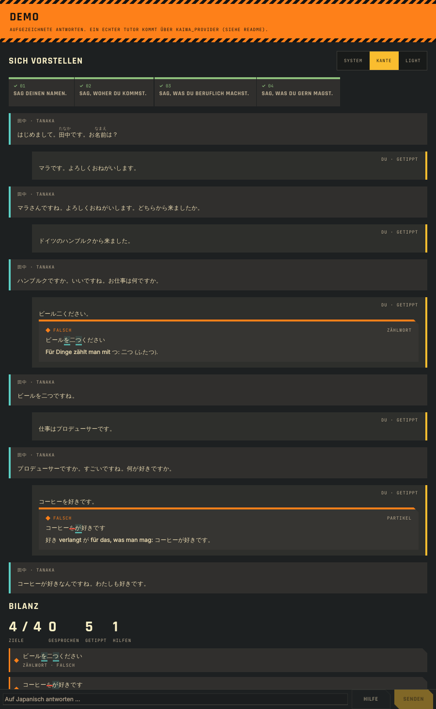
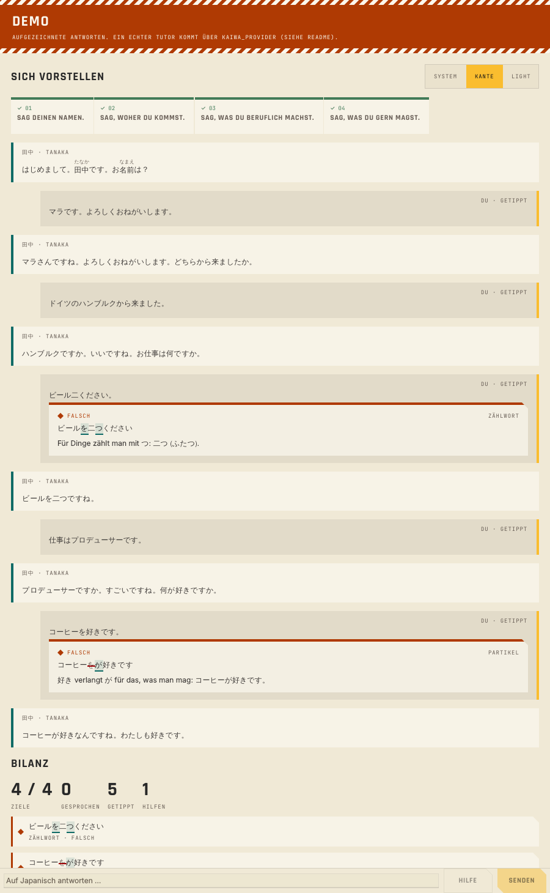
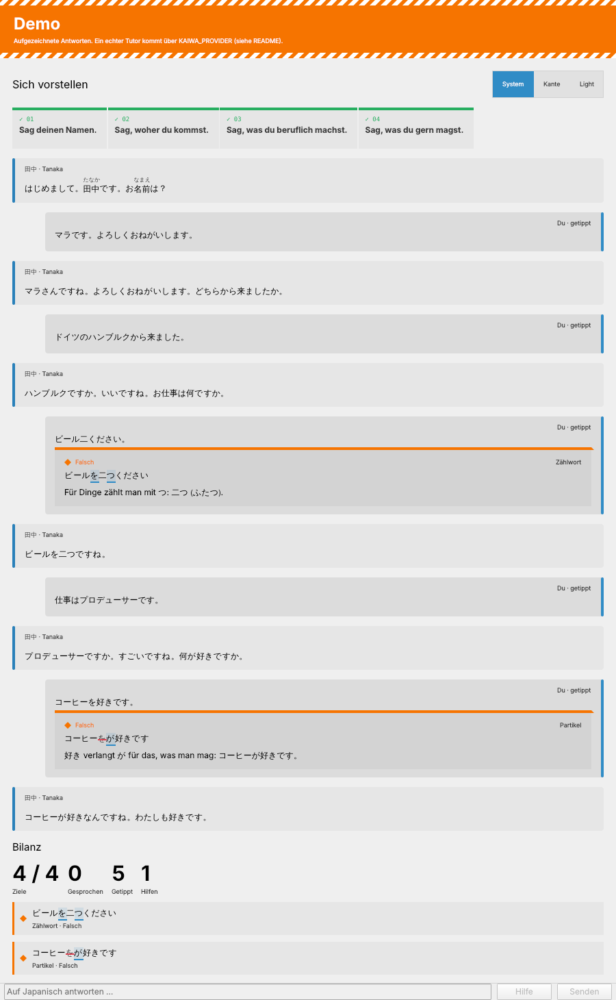

# Kaiwa (App)

Kirigami-App mit der GUI aus Kante 1.25 über `kaiwa-core`. Stand M1: ein Szenario (Sich vorstellen, N5-02). Man antwortet getippt, Hilfe gibt es in drei Stufen. Korrekturen erscheinen als Hint-Cards mit Diff unter dem eigenen Satz, am Ende steht die Bilanz. Sprechen kommt nach den Spikes 0.3 und 0.4.

| Kante (dunkel) | Kante (Leinen) | System |
|---|---|---|
|  |  |  |

## Bauen und starten

```sh
# Qt ≥ 6.6, Kirigami 6, Rust; Kante wird nicht gebraucht (einkompiliert)
cargo run -p kaiwa-app                    # Demo: aufgezeichnete Antworten (qa/fixtures)
```

## Echter Tutor (für den lokalen Test, ADR-004)

```sh
KAIWA_PROVIDER=anthropic ANTHROPIC_API_KEY=… cargo run -p kaiwa-app
KAIWA_PROVIDER=openai KAIWA_OPENAI_BASE=http://localhost:11434/v1 KAIWA_MODEL=qwen3:14b cargo run -p kaiwa-app
```

Ohne diese Variablen läuft die App im Demo-Modus, was ein Banner oben anzeigt. Anthropic nutzt die Voreinstellung aus ADR-004: ein schnelles Modell für die Antwort, ein stärkeres für die Analyse.

## Kante aktualisieren

```sh
tools/sync-kante.sh ../Kante   # Kopie unverändert (GUI-Regel), danach committen
```

## Screenshots

```sh
cargo run -p kaiwa-app -- --shot out.png --kind 1 --light 0 --height 2300 \
  --say '?|マラです。よろしくおねがいします。|コーヒーを好きです。'   # "?" fragt nach Hilfe
```
