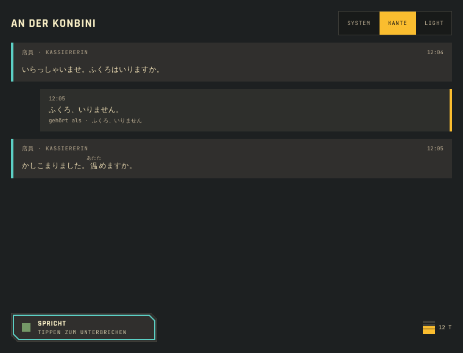
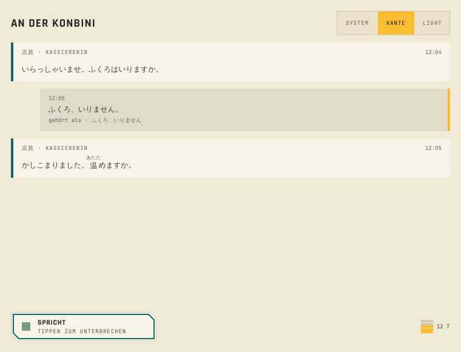
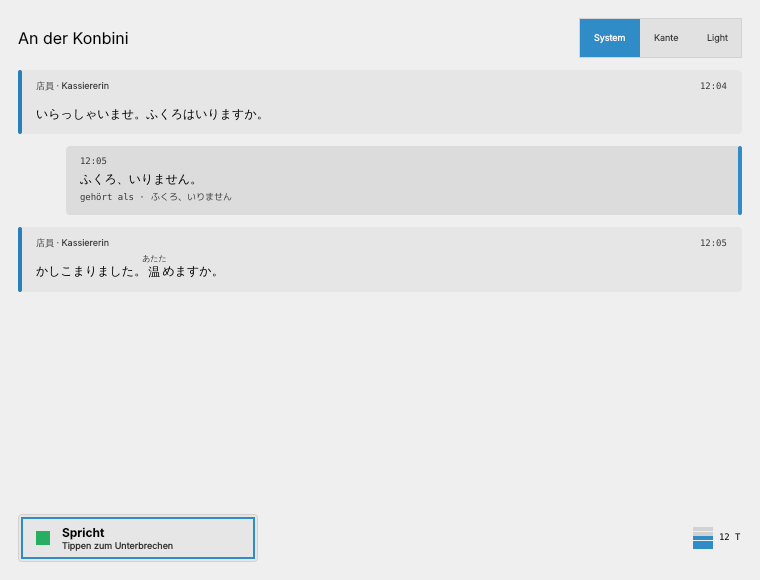

# Spike 0.2: cxx-qt, Kirigami und Kante (ADR-001)

Ein Kirigami-Fenster mit Kante-Bausteinen (Kante 1.25), gesteuert von einem Rust-QObject (`Session`). Die Sprechtaste startet und beendet einen Zug in Rust. Ein Worker-Thread spielt STT und Tutor und gibt das Ergebnis an den Qt-Thread zurück, so wie es die echte Pipeline später tut. Danach spricht die Figur, und ein Tipp unterbricht sie. Der Umschalter oben wechselt zwischen System, Kante und Kante Light.

| Kante (dunkel) | Kante (Leinen) | System |
|---|---|---|
|  |  |  |

## Starten

```sh
# Qt ≥ 6.6 mit Kirigami 6 (Plasma 6 hat beides), Kante daneben ausgecheckt
KANTE_QML=../../../Kante/qml cargo run
cargo run -- --shot out.png --kind 1 --light 0    # ein Zug, Screenshot, Ende
```

Eigener Cargo-Workspace: Haupt-Workspace und CI bauen ohne Qt.

## Ergebnis

| Frage | Befund |
|---|---|
| Baut cxx-qt mit Qt 6.8 und Kirigami 6? | Ja. cxx-qt 0.10.0, Qt 6.8.3 (aqtinstall), Kirigami 6.10 aus den Quellen. Kalter Debug-Build 2 min 13 s (4 Kerne), danach Sekunden |
| QML-Modul aus Rust | `CxxQtBuilder::new_qml_module(QmlModule::new("org.shrippen.kaiwa.spike").qml_file(…))`, `#[qml_element]` auf dem QObject. Kein CMake nötig |
| Eigenschaften | cxx-qt 0.10 behält snake_case: `#[qproperty(i32, talk_state, cxx_name = "talkState")]`, sonst ist `talkState` in QML `undefined` |
| Threads | `impl cxx_qt::Threading` und `qt_thread().queue(…)` bringen Ergebnisse aus Worker-Threads sicher in den Qt-Thread. Schließt das Fenster vorher, gibt `queue` einen Fehler zurück, der Thread endet sauber |
| Kante | `import Kante` über einen Importpfad funktioniert. Alle drei Stile laden ohne Warnung. Gefundener Fehler (rechteckiger Fokusrahmen auf geschnittener Form) ist in Kante #40 behoben |
| Plattform | Ubuntu 24.04 hat nur Qt 6.4, zu alt für KF6-Kirigami. Die App-CI braucht ein Image mit Qt ≥ 6.6 und KF6 (Fragenpaket 2) |

**Entscheidung:** ADR-001 ist angenommen, cxx-qt.

**Für die App:**
- Kante wird nach der GUI-Regel unverändert nach `app/qml/Kante` kopiert, mit einem Sync-Skript und einer CI-Prüfung auf Gleichstand.
- Properties bekommen immer `cxx_name` in camelCase.
